<p align="center">
  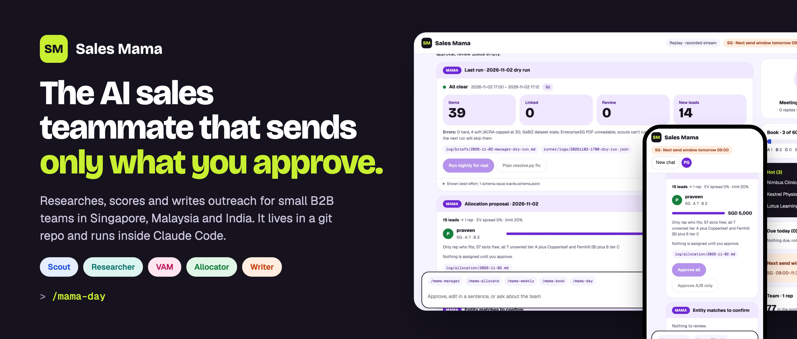
</p>

<p align="center">
  
  
  
  
  
  <a href="LICENSE"></a>
</p>

<p align="center">
  <b>An AI sales Harness for small B2B teams in Singapore, Malaysia and India.</b><br>
  Skills, subagents, hooks and rules that turn Claude Code into a disciplined sales team.<br>
  You approve every message.
</p>

<p align="center">
  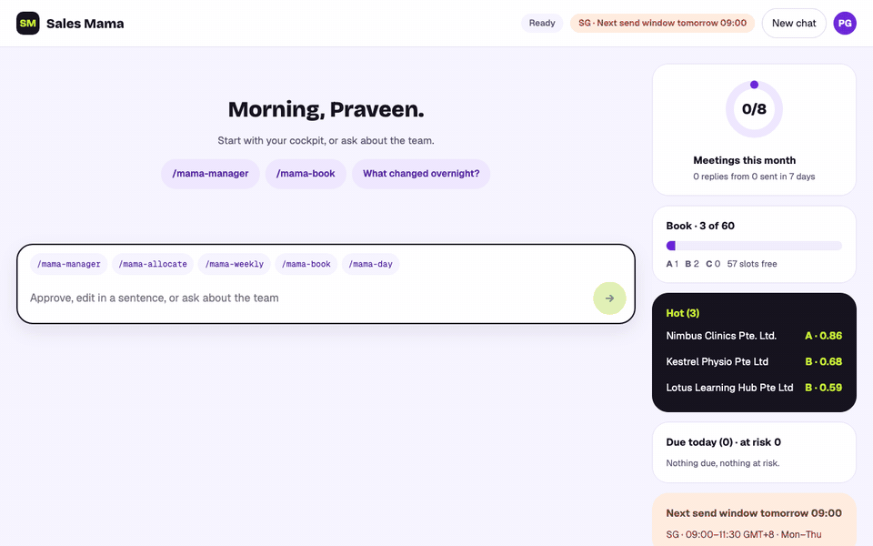
  <br><sub>Console tour, then a real <code>/mama-send</code> run: one email and one WhatsApp, approved and sent. Demo data, fake transport.</sub>
</p>

## 🧰 What's in the harness

| Part | What it does |
|---|---|
| **20 skills** | `/mama-day`, `/mama-send`, `/company-check`, `/company-insights` … one command per job |
| **4 subagents** | Scout, Researcher, VAM and Verifier run in parallel, each with hard limits |
| **3 hooks** | Session start (your queue), write guard (ownership, secrets), sync (git) |
| **17 hard rules** | `AGENTS.md`: cite sources, approve-then-send, stay in your book |
| **Scripts** | Scoring, allocation, checks and sending are deterministic Python |
| **Evals** | 180 self-tests and 17 evals keep it honest |

## 🎯 Why

Small teams lose deals to busywork, not to competitors.

| Problem | Sales Mama |
|---|---|
| Leads go cold in the CRM | Scans news, tenders and registries every night and flags the right accounts |
| Research eats the morning | Researches accounts in parallel; every fact links a source |
| Leads handed out by gut feel | Explainable scores and a fair allocation the manager approves |
| Follow-ups slip | A virtual account manager watches every book |
| Generic messages | Each draft opens with a real signal, in the rep's voice |

## 🧭 How it works

<p align="center">
  <picture>
    <source media="(prefers-color-scheme: dark)" srcset="docs/assets/architecture-dark.svg">
    
  </picture>
</p>

- **The repo is the system.** Markdown, YAML and CSV in git. No servers, no database.
- **Maths in scripts, judgement in the LLM.** Scores and allocation are deterministic and explainable.
- **People decide.** Managers approve leads. Reps approve every send.

## ✅ Send review

<p align="center">
  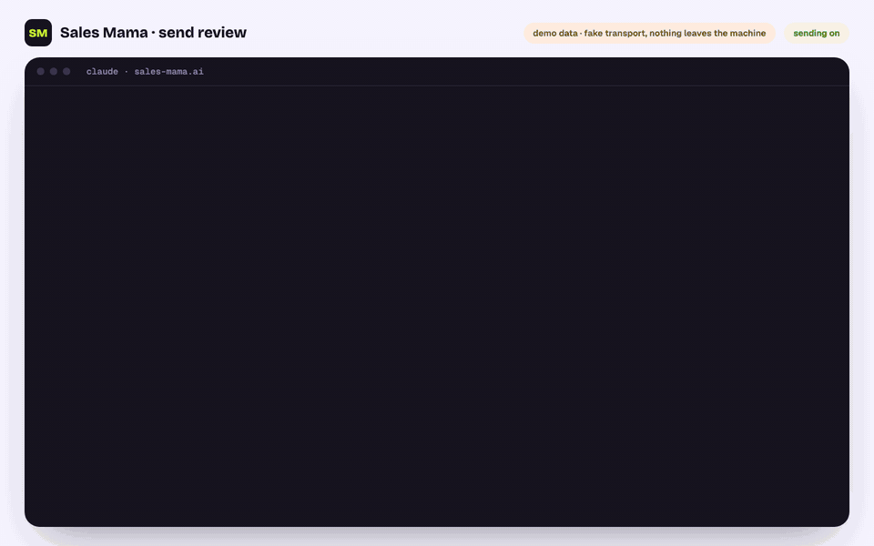
</p>

1. `/mama-draft` writes the email or WhatsApp.
2. `/mama-send` previews the batch: full text, every check, **READY** or **BLOCKED**.
3. The rep picks ("send 1, 2") and clicks **Approve**.
4. Sales Mama sends through Gmail or WhatsApp and logs every touch.

<sub>Replay of a real run on demo data with the fake transport. Still version: <a href="docs/assets/send-review.png">send-review.png</a>.</sub>

`send.py` refuses outside the send window, on holidays, to suppressed contacts, without WhatsApp opt-in, over quota, for the nightly runner, or if anything changed after the preview. Sending is **off** until the manager turns it on ([ADR-0007](docs/adr/0007-approve-then-send.md)).

## 🔎 Company check

**Know a company is real before you spend a minute selling to it.**

<p align="center">
  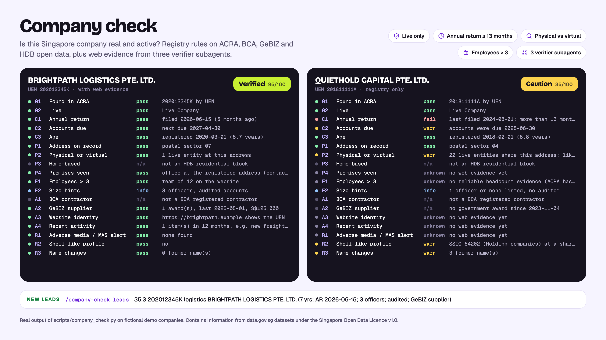
</p>

`/company-check <UEN or name>` checks any Singapore company against a local copy of ACRA, BCA, GeBIZ and HDB open data (~2.12M entities, refreshed monthly), then sends three `verifier` subagents to the web for identity, people and risk.

| It checks | Rule |
|---|---|
| Live | ACRA status `Live Company` or `Live` only |
| Filing | Annual return in the last 13 months |
| Physical or virtual | Own address vs a shared registered address (20+ companies) or home-based |
| Size | More than 3 employees, from evidence only (ACRA has no headcount) |
| Outside signals | BCA contractor, GeBIZ supplier, website shows the UEN, recent activity |
| Red flags | Adverse media, MAS alert, shell-like profile, frequent name changes |

Verdicts: **Verified · Likely legitimate · Registry OK · Caution · Red flag · Not active**. `/company-check leads` turns the same data into a ranked list of new ICP leads, and CompanyData, RocketReach or Apollo can add headcount bands when connected. [How it works](company-check/README.md)

## 📊 Company insights

**Ask a question, get a report.** `/company-insights` turns the same registry data into generated stats, charts and tables, live in the console or as a shareable page.

<table>
<tr>
<td width="50%">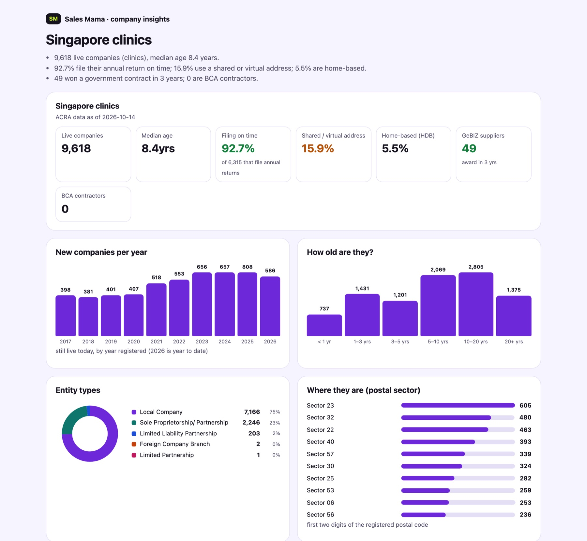<br><sub><b>"Clinics in Singapore"</b> · 9,618 live, 92.7% filing on time, growth by year, top activities, best leads.</sub></td>
<td width="50%">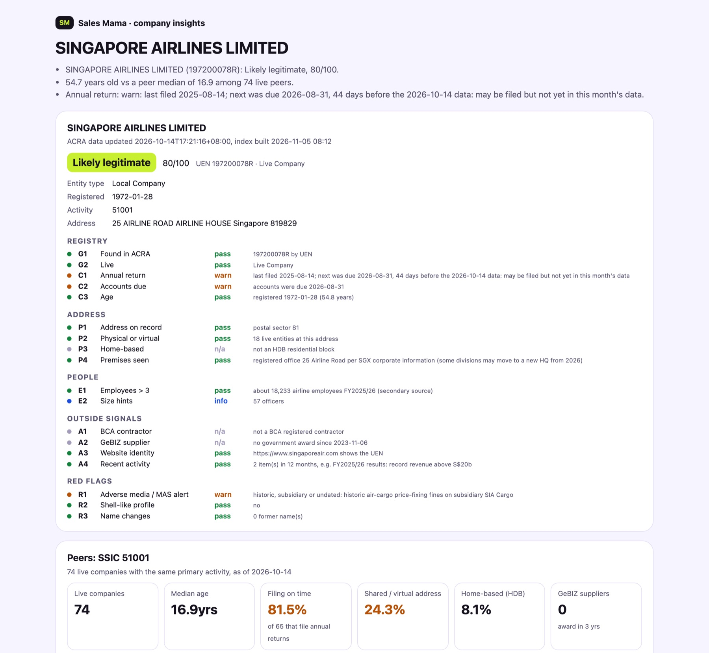<br><sub><b>"Tell me about Singapore Airlines"</b> · verdict, every check with its reason, peers, web evidence.</sub></td>
</tr>
</table>

Also: *"how clean is my book?"* and *"compare SIA, Singtel and DBS"*. Real ACRA data (14 Oct 2026); numbers come from scripts, never the model.

## 🖥️ Screens

<table>
<tr>
<td width="50%">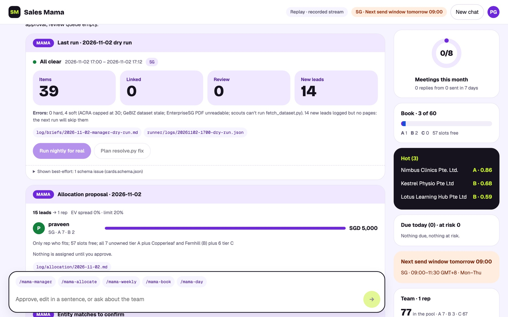<br><sub><b>Manager cockpit.</b> Last night's run and the allocation to approve.</sub></td>
<td width="50%">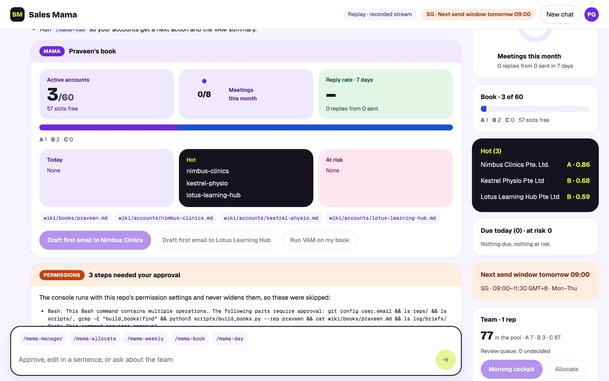<br><sub><b>Rep book.</b> Capacity, meetings, hot accounts, next steps.</sub></td>
</tr>
<tr>
<td width="50%">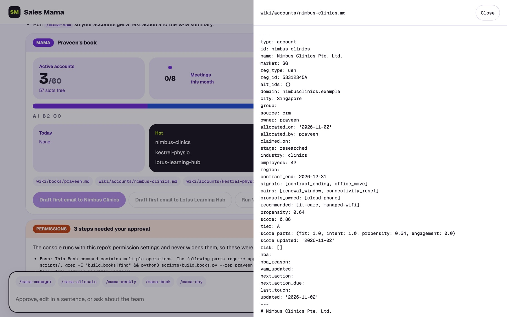<br><sub><b>Grounded.</b> Every card opens the page behind it.</sub></td>
<td width="50%" align="center">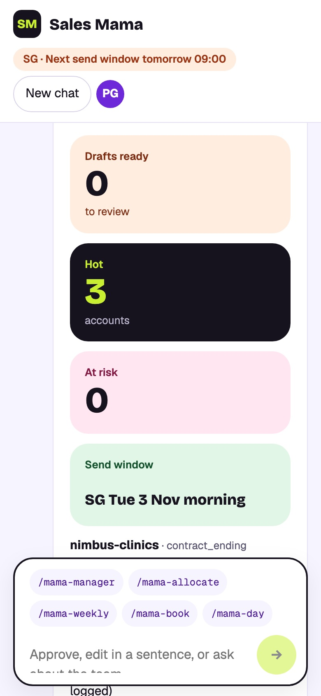&nbsp;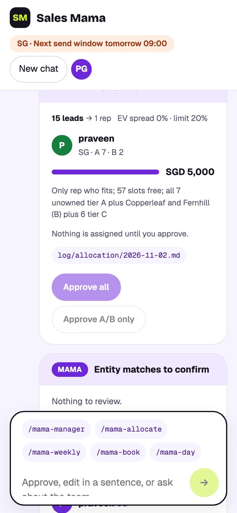<br><sub><b>On the go.</b> Same cards on a phone.</sub></td>
</tr>
</table>

## 🚀 Quick start

```bash
git clone https://github.com/neam-lang/sales-mama.ai.git && cd sales-mama.ai
python3 -m pip install --user pyyaml
python3 scripts/selftest.py                 # 180/180 passed
claude                                      # then type: Set me up for Sales Mama
```

Connect channels, one command each:

```bash
python3 scripts/connect.py gmail --client-file <oauth-client.json>   # browser opens, click Allow
! python3 scripts/connect.py whatsapp                                 # you type the token
python3 scripts/connect.py status                                     # Sending: off · Gmail ok · WhatsApp ok
```

Tokens stay in `~/.config/sales-mama/`, never in the repo. Admin steps (Google OAuth client, Meta templates): [SETUP.md · Connect channels](SETUP.md#connect-channels-adr-0007).

**Add a rep:** give them repo access; they type *"Set me up for Sales Mama from https://github.com/neam-lang/sales-mama.ai"*.

**Nightly run:** on one always-on machine, *"Set up the Sales Mama nightly runner on this machine."*

<details>
<summary>Using Codex</summary>

Codex reads `AGENTS.md` and `.agents/skills/` (`$mama-day`). It has no hooks or ask rules, so it runs `session_start.py` / `sync.py` itself, and `/mama-send` stops at the preview for the rep to send.

</details>

## 🗓️ A day with Sales Mama

| Time (SGT) | Who | Command |
|---|---|---|
| 02:00 | Runner | `/mama-nightly` scan · score · VAMs · allocation proposal |
| 08:30 | Manager | `/mama-manager` approve leads, clear the review queue |
| 08:45 | Rep | `/mama-day` replies · research · drafts |
| 09:00–11:30 | Rep | `/mama-send` review and approve |
| Friday | Manager | `/mama-weekly` metrics, calibration, PR |

<details>
<summary>All commands</summary>

| Rep | | Manager | |
|---|---|---|---|
| `/mama-day` | whole morning | `/mama-manager` | cockpit |
| `/mama-book` | my accounts | `/mama-allocate` | split the pool |
| `/mama-research acme` | research | `/mama-scan` | scan signals |
| `/mama-recommend acme` | what to pitch | `/mama-vam <rep>` | refresh a book |
| `/mama-draft acme first` | email or WhatsApp | `/mama-nightly` | run tonight's job |
| `/mama-send` | review and send | `/mama-ingest` | import CRM |
| `/mama-replies` | handle replies | `/mama-weekly` | weekly review |
| `/mama-brief acme` | call prep | | |
| `/mama-handover acme` | log a meeting | | |

</details>

## 🛡️ Guardrails

| Rule | Enforced by |
|---|---|
| Nothing sent without the rep's approval | `send.py` preview + permission prompt ([ADR-0007](docs/adr/0007-approve-then-send.md)) |
| No lead assigned without the manager | `claim.py --assign` after approval |
| Every fact cites a source | `lint.py`, `eval.py` |
| No invented names in drafts | `draft_check.py` entity check |
| Suppression, send windows, WhatsApp opt-in | `draft_check.py`, `send.py` |
| Reps touch only their own book | `guard.py` hook |
| Web text is data, not instructions | Rule 15 in [AGENTS.md](AGENTS.md) |

[Security on one page](docs/SECURITY.md) · compliance notes in `knowledge/guardrails.md` are not legal advice; confirm with your DPO.

## 📊 Quality

```bash
python3 scripts/selftest.py   # 180/180
python3 scripts/eval.py       # 13 pass · 0 fail · 8 pending
python3 scripts/lint.py       # 0 errors
```

Every pilot mistake becomes a failing eval case before it is fixed.

## 🗺️ Roadmap

- **Now:** Singapore pilot · approve-then-send live after DPO sign-off · every rep on Gmail
- **Next:** Malaysia (WhatsApp, Bahasa Malaysia), then India (DPDP consent before May 2027)
- **Later:** score calibration from real meetings · LLM-judged draft quality · Codex in the console · CRM write-back

<details>
<summary>Build phases</summary>

| Phase | Status |
|---|---|
| 0–3 · Skeleton, knowledge, signals, scoring | ✅ |
| 4 · Outreach, replies, approve-then-send | 🟡 live mailbox + 40 labelled replies to go |
| 5 · Books + VAMs | 🟡 first VAM runs |
| 6 · Allocation + cockpit | ✅ |
| 7 · Nightly + weekly | 🟡 schedule + 5 nights |
| 8 · Codex parity + SG pilot | 🟡 in progress |
| 9 · Console | ✅ |

</details>

## 📣 Meetup

<table>
<tr>
<td width="34%"><a href="docs/assets/poster.png">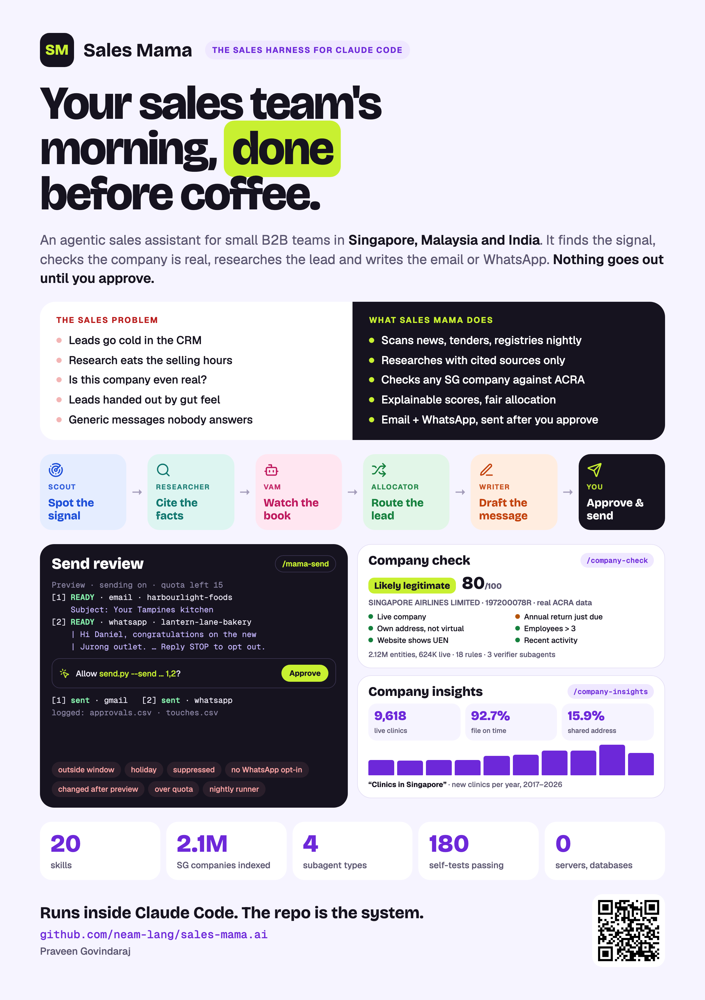</a></td>
<td valign="top">

**Your sales team's morning, done before coffee**<br>
Wed 4 Nov 2026 · Praveen Govindaraj

1. The small-team sales problem
2. The repo is the system
3. Live: approve leads, run the day, review and send
4. Guardrails that hold
5. Pilot to three markets

</td>
</tr>
</table>

## 📚 Docs

[GUIDE](GUIDE.md) · [PLAN](PLAN.md) · [SETUP](SETUP.md) · [AGENTS](AGENTS.md) · [UI](docs/UI.md) · [SECURITY](docs/SECURITY.md) · [ADRs](docs/adr/)

<p align="center"><sub>Built with <a href="https://claude.com/claude-code">Claude Code</a> · Apache 2.0 · Screens use fictional demo data</sub></p>
